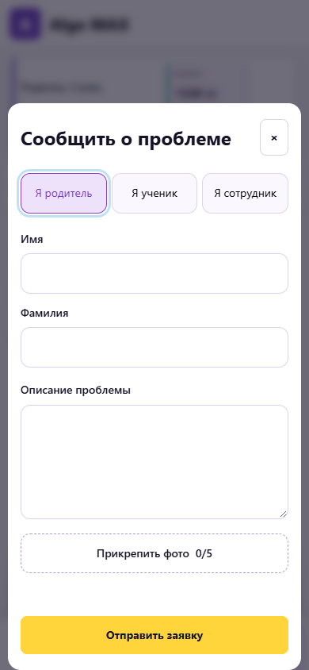

# Algo MAX

**Школьная жизнь внутри MAX: достижения, награды и связь с родителями.**

MAX-бот · миниприложение · кабинет преподавателя · управление школой · игры

[Интерфейс](#интерфейс) · [Возможности](#возможности) · [Игры](#игры) · [Архитектура](#архитектура) · [Локальная демонстрация](#локальная-демонстрация)

Algo MAX объединяет учеников, родителей и сотрудников в одном приложении. Ученики копят астрокоины и выбирают награды, родители следят за результатами детей, преподаватели работают со своими группами, а администрация управляет заказами, доступами и обращениями.

*Скриншоты сняты с работающего интерфейса на локальном стенде в ноябре 2026 года. Имена, балансы и заказы демонстрационные; QR-коды не предназначены для подключения. Это интерфейс приложения, а не дизайн-макеты.*

## Возможности

| Для кого | Что доступно |
| --- | --- |
| **Ученик** | Баланс и история AC, магазин, избранное, корзина, заказы и банковский вклад. В игровом пилоте — тренировки, соревнования, достижения и личный прогресс. |
| **Родитель** | Семейный кабинет с переключением между детьми, их балансы и заказы, QR-код ребёнка, просмотр групповых сборов и обращение в поддержку. |
| **Преподаватель** | Свои группы и карточки учеников, поиск в списке QR-кодов, ссылки подключения родителей, начисления AC, выдача заказов и подготовка обратной связи по занятиям. |
| **Куратор и администратор** | Работа с учениками, заказами, товарами, складами, импортом, рассылками и историей в пределах назначенных полномочий. |
| **Директор** | Управление сотрудниками и ролями, отчёты, варианты групповых сборов и контроль их выполнения. |
| **Суперадминистратор** | Управление городами и партнёрами, подробный аудит, диагностика привязок и обработка обращений пользователей. |

Набор действий зависит от роли, города, партнёра и назначенных площадок. Один сотрудник может совмещать несколько ролей.

### Астрокоины, магазин и выдача наград

- Индивидуальные и групповые начисления с указанием причины и автора операции.
- Баланс, подробная история движения AC и отчётность для сотрудников.
- Банковский вклад с ежедневным расчётом процентов и ежемесячной капитализацией.
- Каталог с поиском, категориями, остатками, избранным и корзиной.
- Заказ проходит путь от резервирования и назначения склада до передачи преподавателю и выдачи ученику.
- Физические и цифровые товары, импорт из XLSX, управление складами и остатками.

### Подключение и семейный доступ

Родитель открывает персональную ссылку из письма школы и нажимает **«Начать»** в боте. Ученик подключается по своему QR-коду. Родительский аккаунт может объединять нескольких детей семьи; у ученика допускается одна действующая привязка ученического аккаунта.

Преподавателю доступны поиск ученика, его QR-код и ссылка подключения родителя. История позволяет понять, кто и когда подключился, к какому ученику относилось действие и чем закончилась попытка входа.

### Обратная связь по занятиям

- Выбор своей группы и актуального прошедшего занятия с заполнением настроек и текста ОС.
- Материалы курса, тема, дата и отметки отсутствующих учеников в одном рабочем сценарии.
- Расписание с датой первого занятия, интервалом или днями недели, повторами, выключением и добавлением занятий.
- Собственные группы и индивидуальные занятия, даже если их нет в импорте астрокоинов.
- Редактирование подготовленного текста и восстановление рабочего состояния при повторном входе.
- Расписания сохраняются на сервере с привязкой к аккаунту преподавателя.

### Групповые сборы

Директор создаёт варианты сбора, преподаватель открывает сбор для своей группы, ученики вносят одинаковую долю астрокоинов. Карточка выделяется в магазине, показывает срок, сумму и число участников. Если цель не достигнута к сроку, взносы возвращаются автоматически.

Родители видят ход сбора; бот уведомляет о начале. При достижении цели уведомления получают преподаватель и директор. Организационные этапы доступны сотрудникам, а детям и родителям показывается результат сбора. Варианты можно редактировать и удалять; сборы поддерживают пиццу и другие общие цели.

### Помощь, обращения и история

В разделе помощи собраны инструкции и пошаговые видео. Сообщить о проблеме можно из миниприложения или бота: выбрать роль, указать имя, описать ситуацию и приложить фотографии. При обращении через бота дополнительно запрашивается город, а у родителя — имя и фамилия ребёнка.

Обращение содержит сведения об аккаунте и связанных учениках. Суперадминистратор может ответить пользователю в личные сообщения от бота и завершить тикет. Пользователь не закрывает обращение самостоятельно.

Общая история показывает понятные события и переходы к карточкам учеников. Отдельный аудит для суперадминистратора содержит подробности действий, подтверждённые MAX/LMS ID, результаты попыток и группировку последовательных событий пользователя.

### Управление школой

- Импорт учеников, групп и товаров из XLSX, работа с данными CRM/LMS.
- Сотрудники, приглашения, назначение ролей и доступ к площадкам.
- Ссылки и QR-коды подключения, просмотр состояния привязок.
- Массовые рассылки и уведомления в боте.
- История операций, отчёты AC и подробная диагностика для суперадминистратора.
- Несколько городов и партнёров с разделением данных и полномочий.

## Интерфейс

Нажмите на изображение, чтобы открыть его в полном размере.

| Магазин наград | Работа с заказами |
| --- | --- |
|  |  |
| **Обратная связь преподавателя** | **Групповой сбор в магазине** |
|  |  |
| **Банк ученика** | **QR-коды у преподавателя** |
|  |  |

<strong>Мобильная форма обращения в поддержку</strong>

## Игры

Дополнительный раздел из **16 игр**: тренировки, обучение, уровни, соревнования, общий рейтинг и достижения. Есть задания на логику, печать, Python, память и реакцию. Раздел проходит ограниченный пилот; игровые AC предусмотрены только ученикам и пока изолированы от школьных кошельков.

## Архитектура

~~~mermaid
flowchart LR
    U[Ученик · Родитель · Сотрудник] --> M[MAX]
    M --> B[Бот]
    M --> W[Миниприложение]
    B --> A[FastAPI · ролевой API]
    W --> A
    A --> P[(PostgreSQL)]
    A --> R[Redis · ограничения запросов]
    A --> J[Фоновые процессы]
    J --> B
    A --> G[Игровой пилот · проверка записей ввода]
    G --> S[(Отдельная SQLite)]
    X[XLSX · CRM / LMS] --> A
~~~

| Слой | Технологии и назначение |
| --- | --- |
| **Сервер** | Python 3.11+, FastAPI, Pydantic, SQLAlchemy, Alembic. |
| **Основные данные** | PostgreSQL: ученики, привязки, роли, кошельки, операции, заказы и расписания. |
| **Миниприложение** | HTML, CSS и JavaScript; адаптивные экраны и проверка подписанных данных запуска MAX. |
| **Бот** | Вход и привязки, уведомления, обращения и переход в личный кабинет. |
| **Фоновые задачи** | Банковские проценты, награды ко дню рождения, сроки сборов и доставка уведомлений. Redis используется в распределённых ограничениях запросов. |
| **Игры** | Общие правила на JavaScript и серверное воспроизведение ввода в V8; отдельное хранилище пилота. |

Авторизация и права проверяются сервером. Данные ограничиваются городом и партнёром; операции с балансами, заказами и остатками выполняются транзакционно. Клиентский счёт в играх не принимается на доверии: сервер воспроизводит партию. Это защищает от подмены результата, но не является гарантией защиты от автоматизированной игры.

## Локальная демонстрация

Основная ветка **main** и ветка разработки могут содержать разные версии приложения. Актуальный код игровых демонстраций находится в [**work/games-prototype**](https://github.com/ImDoubleU/algo-bot-max/tree/work/games-prototype). Скриншоты показывают текущую локальную сборку; доступность отдельных модулей в рабочем приложении управляется настройками и ролями.

Локальный стенд позволяет посмотреть сборы от имени ученика, родителя, преподавателя и директора. Пример для PowerShell, Python 3.11+:

~~~powershell
git clone https://github.com/ImDoubleU/algo-bot-max.git
cd algo-bot-max
git switch work/games-prototype
python -m venv .venv
.venv/Scripts/python.exe -m pip install -r requirements.txt
.venv/Scripts/python.exe -m app.cli.pizza_preview
~~~

Открыть **http://127.0.0.1:8770/**. Роль выбирается в меню стенда. Используются вымышленные ученики и отдельная SQLite-база в .deploy_tmp; настоящие школьные кошельки и привязки не используются, сообщения в MAX не отправляются.

Игровой стенд запускается отдельно после установки requirements-games.txt:

~~~powershell
.venv/Scripts/python.exe -m pip install -r requirements-games.txt
.venv/Scripts/python.exe -m app.cli.games_preview
~~~

Адрес — **http://127.0.0.1:8772/**. Прогресс сохраняется в отдельном локальном хранилище.

Для полного приложения предусмотрены PostgreSQL и Redis в [docker-compose.yml](docker-compose.yml), примеры конфигурации [.env.example](.env.example) и [.env.sqlite.example](.env.sqlite.example), миграции в alembic/ и конфигурации запуска в deploy/. Локальные стенды запускаются отдельно от рабочего окружения.

## Лицензия

Проект опубликован для демонстрации профессиональных навыков автора. Это **source-available**, а не open-source проект; условия просмотра и использования описаны в [LICENSE](LICENSE).
