

# Algo MAX

**MAX-бот и миниприложение для учеников, родителей и сотрудников школы.**

[Возможности](#возможности) · [Управление](#управление) · [Интерфейс](#интерфейс) · [Игры](#игры) · [Архитектура](#архитектура)

В Algo MAX ведут учёт астрокоинов, оформляют и выдают награды, управляют учениками, сотрудниками и складами. Родители видят балансы и заказы детей, преподаватели работают со своими группами и готовят сообщения о занятиях.

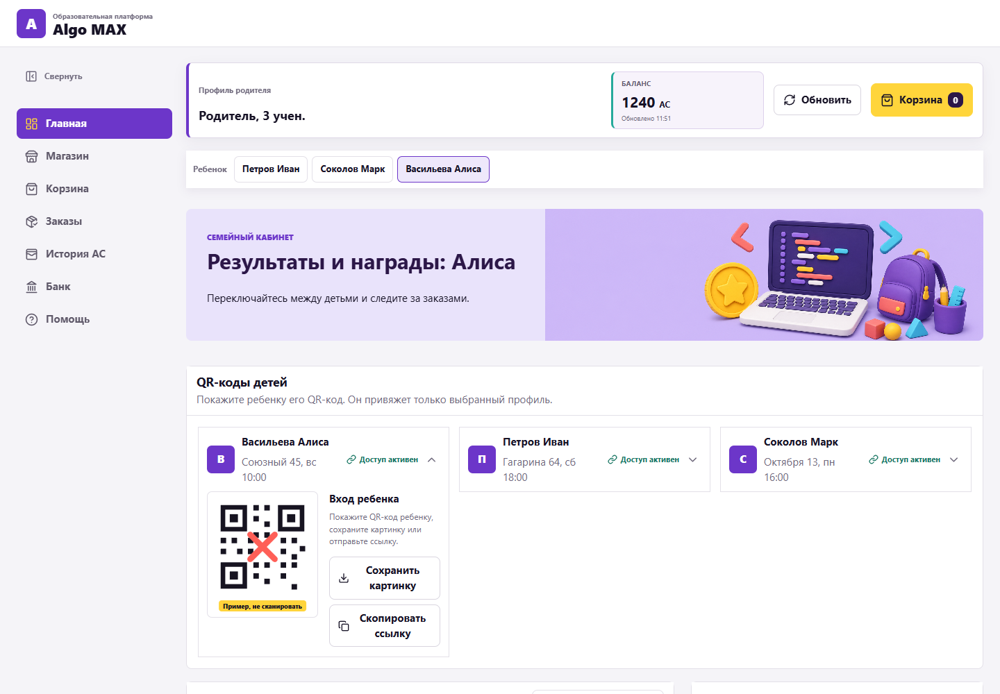

*На скриншотах — вымышленные профили и учебные данные.*

## Возможности

| Роль | Основные разделы |
| --- | --- |
| **Ученик** | Баланс и история AC, магазин, избранное, корзина, заказы, банк, групповые сборы и игры. |
| **Родитель** | Балансы и заказы детей, переключение между их профилями, QR-коды подключения, просмотр сборов и поддержка. |
| **Преподаватель** | Свои группы, карточки учеников, начисления, QR-коды, выдача заказов, обратная связь и групповые сборы. |
| **Куратор и администратор** | Ученики, заказы, каталог, склады, импорт, рассылки и история. |
| **Директор** | Сотрудники и роли, отчёты, каталог и варианты групповых сборов. |
| **Суперадминистратор** | Доступ к городам и партнёрам, аудит, диагностика подключений и обращения пользователей. |

Доступ к действиям определяется ролью и назначенными городами и площадками. У сотрудника может быть несколько ролей.

### Подключение родителей и детей

Родитель переходит по персональной ссылке из письма школы и нажимает **«Начать»** в боте. Его аккаунт может быть связан с несколькими детьми семьи.

Ребёнок подключается по своему QR-коду. Он доступен в семейном кабинете и у преподавателя. У ученика может быть только одна действующая привязка ученического MAX-аккаунта.

В списке QR-кодов преподаватель ищет ребёнка по имени, видит состояние подключений и может скопировать ссылку для родителя. В карточке ученика отображаются связанные аккаунты и их MAX ID.

### Астрокоины и банк

- Индивидуальные и групповые начисления с причиной операции и именем сотрудника.
- Личный баланс, история начислений, покупок, возвратов и банковских операций.
- Корректировка баланса с комментарием и отдельной записью в истории.
- Банковский вклад: открытие, пополнение и досрочное закрытие.
- Ежедневный расчёт процентов и ежемесячная капитализация.
- Настройка процентной ставки по городу, просмотр вкладов, внесённых сумм и начисленных процентов.
- Отчёты по начислениям за период с фильтрами по преподавателю и группе.

### Магазин

**Для ученика:** поиск товаров, категории, сортировка, избранное и фильтр наличия. В карточке показаны цена в AC и доступное количество. Ученик выбирает награды, добавляет их в корзину, проверяет состав и сумму, затем подтверждает заказ.

**Для директора:** создание и редактирование каталога, импорт товаров из CSV/XLSX, настройка названий, описаний, категорий, цен, изображений и остатков по складам. Поддерживаются физические товары и цифровые награды с ручной выдачей или выдачей кода.

### Обработка заказов

**Директор** видит заказы учеников, назначает склад для каждой позиции и подтверждает сборку. Готовые заказы сгруппированы по площадкам и преподавателям: можно отметить переданные заказы и подтвердить доставку на площадку. Поиск и фильтры показывают, какие заказы нужно собрать, передать или выдать.

**Преподаватель** подтверждает приём кнопкой «Принять заказ», а после передачи награды ребёнку нажимает «Выдать ученику». Этапы передачи сохраняются в истории.

**Заказавший ученик** в разделе «Заказы» видит состав, стоимость и текущий статус своего заказа. Уведомления приходят в MAX; родитель может проверить заказ в кабинете ребёнка. Для цифровой награды код сохраняется в карточке заказа и доступен ученику и связанному родителю.

При отмене требуется подтверждение. Списание AC, возврат и изменения заказа сохраняются в истории; остатки учитывают зарезервированные товары.

### Обратная связь по занятиям

При выборе группы подставляется ближайшее прошедшее занятие: курс, материал, дата и текст сообщения. Преподаватель отмечает отсутствующих и при необходимости редактирует текст.

Расписание поддерживает дату первого занятия, заполнение по интервалу или дням недели, повторы, выключение уроков и добавление собственных тем. Можно создавать свои группы и индивидуальные занятия. Расписание хранится на сервере у преподавателя, а рабочее состояние раздела восстанавливается при повторном входе.

### Групповые сборы

Директор создаёт и редактирует варианты сбора. Преподаватель выбирает вариант, группу и срок. В магазине появляется карточка с таймером, суммой, числом участников и одинаковым взносом с ученика.

Если к сроку цель не достигнута, взносы возвращаются автоматически. Родители могут следить за сбором. О начале бот уведомляет учеников и родителей, о достижении цели — преподавателя и директора. Дальнейшие этапы заказа отмечают сотрудники.

## Управление

### Ученики и группы

В реестре есть поиск по ФИО, группе, ID и преподавателю, фильтры по группе и статусу обучения. Карточка ученика содержит курс, преподавателя, площадку, дату рождения, связанные аккаунты, баланс, вклад и историю.

Сотрудник с правами управления может добавить ученика вручную, изменить его данные, группу, преподавателя и статус, скорректировать баланс или отключить ошибочную привязку. Изменения сохраняются с указанием ответственного.

### Импорт учеников

Ученики и группы загружаются из XLSX. Предусмотрены шаблон файла, отдельный импорт активных и выбывших учеников и проверка перед подтверждением.

До загрузки показаны количество строк, групп, курсов и преподавателей, наличие ID контактов и распределение по городам. Импорт создаёт новые карточки и обновляет существующие; его результаты отражаются в истории ученика.

### Каталог, импорт товаров и склады

- Добавление и редактирование товаров, категорий, цен, изображений и способа выдачи.
- Импорт каталога из **CSV или XLSX**, скачиваемый шаблон.
- Учёт общего, свободного и зарезервированного количества по каждому складу.
- Создание и редактирование складов, подключение к городу, выбор основного склада для назначения заказов.
- Сводка: заказы в работе, ожидающие выдачи, активные товары, резервы и низкие остатки. Из сводки можно перейти к нужному заказу или товару.

### Сотрудники и доступы

Сотрудника можно пригласить одноразовой ссылкой или назначить по MAX ID. В настройках доступны изменение ФИО, добавление и отзыв ролей, поиск по имени, MAX ID и роли. Один аккаунт может совмещать преподавательскую и административную работу.

Города и партнёры разделены: выбранный город определяет учеников, каталог, заказы, отчёты и доступные сотруднику действия.

### Уведомления и рассылки

Бот сообщает об этапах заказов, групповых сборах и ответах на обращения. Сотрудники настраивают доступные им категории уведомлений.

Для рассылки выбираются родители, ученики или обе категории, группы и площадки. Дополнительные фильтры позволяют выбрать, например, учеников с небольшим балансом или с активными заказами. Можно приложить изображение, проверить текст и состав получателей до отправки. Сохраняются история рассылок и результаты доставки.

### Связи, история и аудит

В разделе связей показаны подключения родителей и учеников. Есть поиск по имени и ID, отключение аккаунта и экспорт в Excel.

История содержит подключения, начисления, изменения карточек и обработку заказов. Для действий с учеником показаны время, участники и ссылка на его карточку.

Суперадминистратору доступен подробный аудит с поиском и фильтрами по периоду, разделу и результату. Он показывает MAX ID участника, подтверждённые LMS ID, роль, группу и обстоятельства попытки. Последовательные действия одного пользователя объединяются в группы событий.

### Помощь и обращения

В помощи есть инструкции и пошаговые видео. Обращение можно создать в боте или миниприложении: выбрать роль, указать имя и фамилию, описать проблему и приложить фотографии. В боте дополнительно запрашивается город, у родителя — имя и фамилия ребёнка.

У обращения сохраняются MAX ID автора и сведения о связанных учениках. Суперадминистратор получает уведомление, может ответить пользователю от бота, завершить или удалить тикет.

## Интерфейс

Изображения открываются в полном размере по нажатию.

### Кабинеты и награды

| Магазин наград | Обработка заказов |
| --- | --- |
| [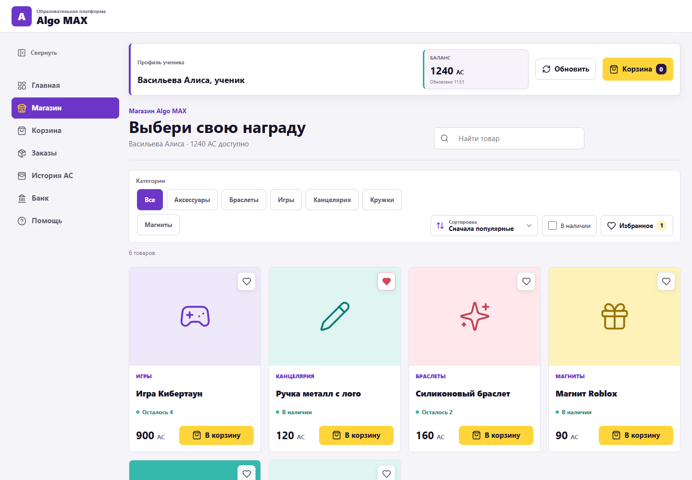](docs/screenshots/store.png) | [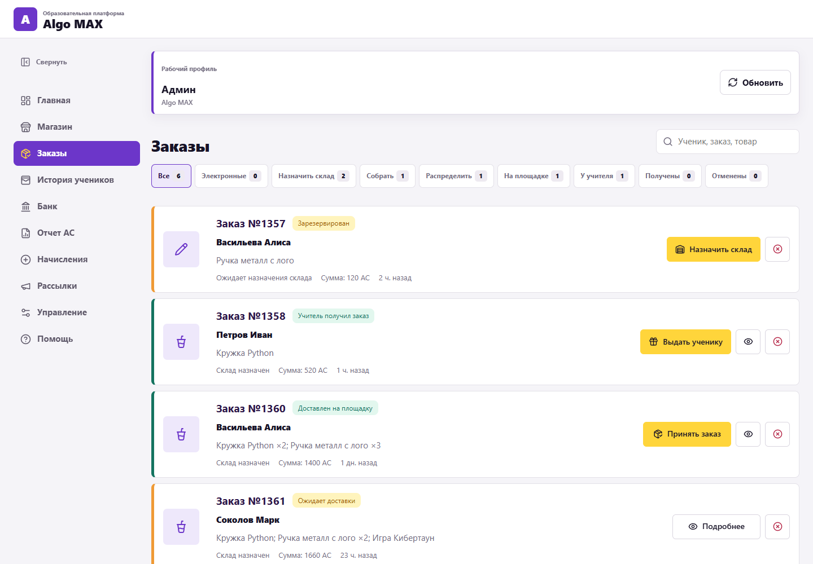](docs/screenshots/orders.png) |
| **Обратная связь преподавателя** | **Групповой сбор** |
| [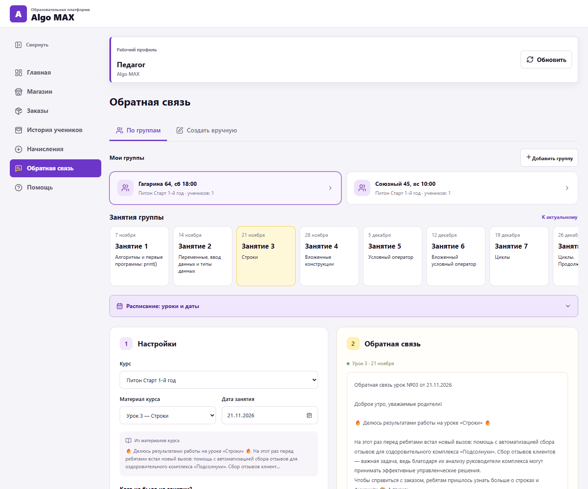](docs/screenshots/feedback.png) | [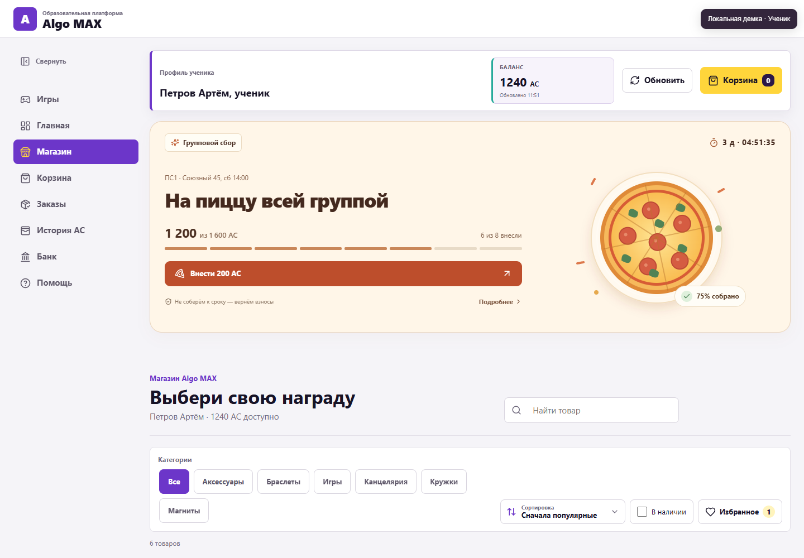](docs/screenshots/group-collection.png) |
| **Банк ученика** | **Подключение учеников и родителей** |
| [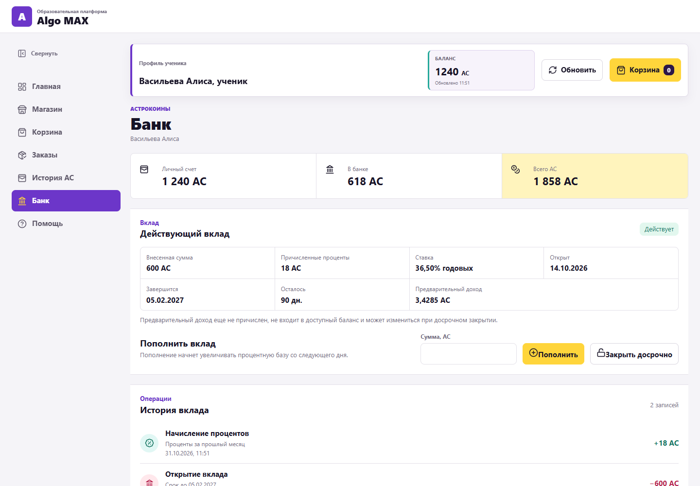](docs/screenshots/bank.png) | [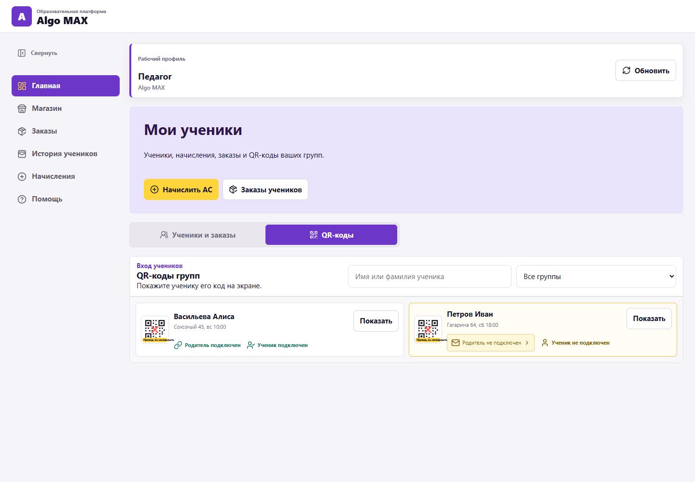](docs/screenshots/teacher-qr.png) |

### Управление и передача заказов

| Товары и остатки у директора | Настройка сотрудников |
| --- | --- |
| [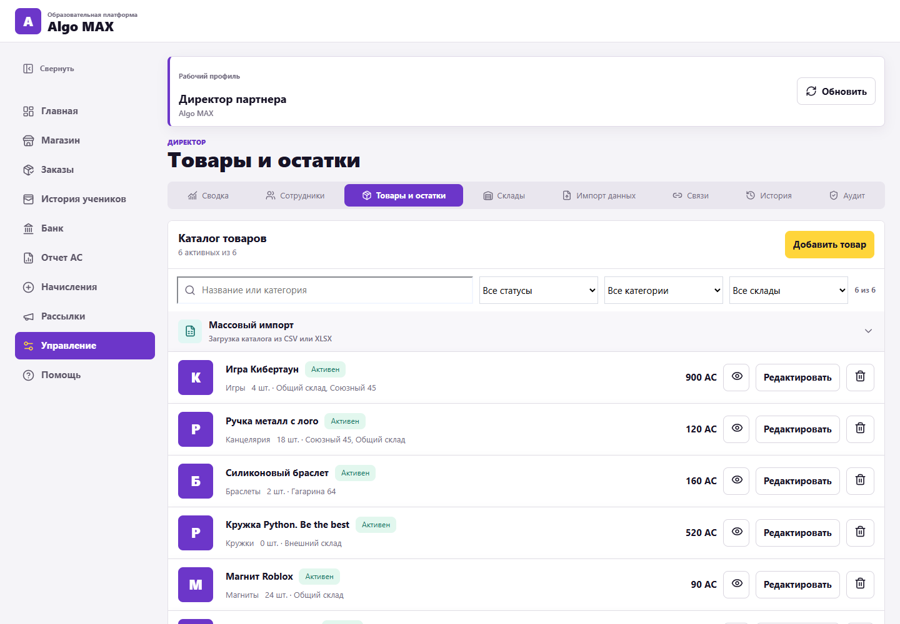](docs/screenshots/products-management.png) | [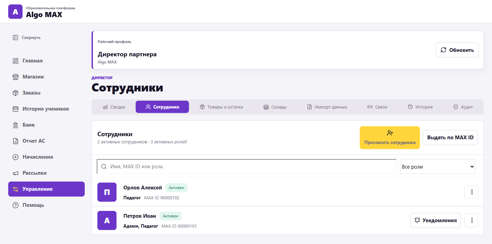](docs/screenshots/staff-management.png) |
| **Карточка ученика** | **Импорт учеников и групп** |
| [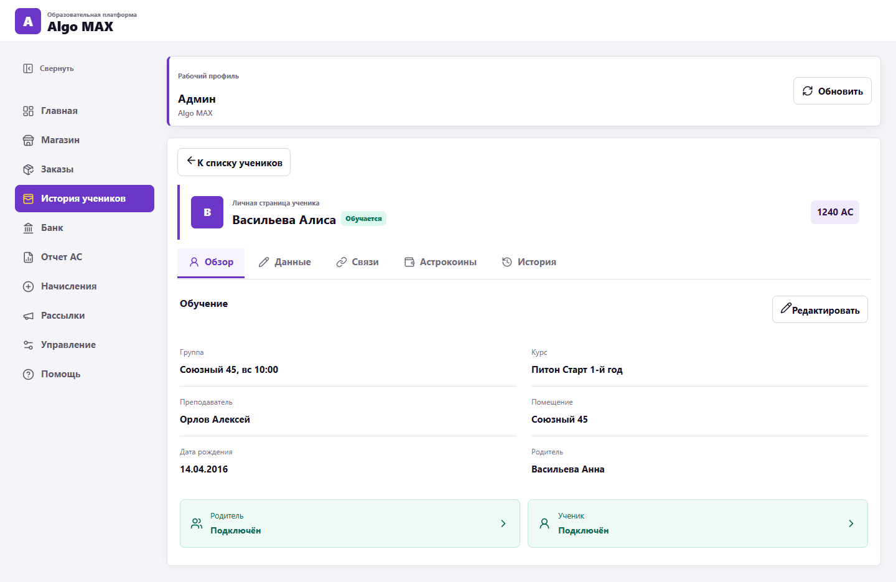](docs/screenshots/student-profile.png) | [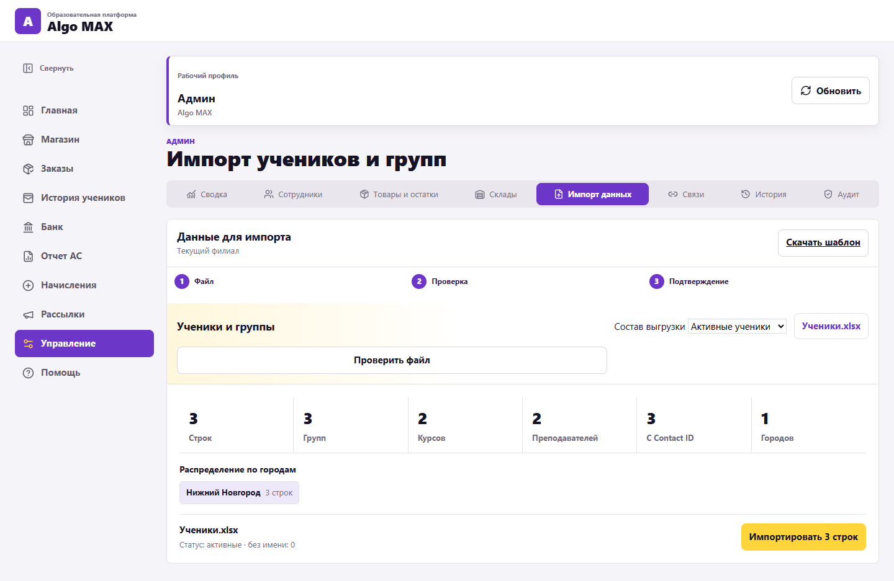](docs/screenshots/students-import.png) |
| **Передача заказов директором** | **Заказы со стороны ученика** |
| [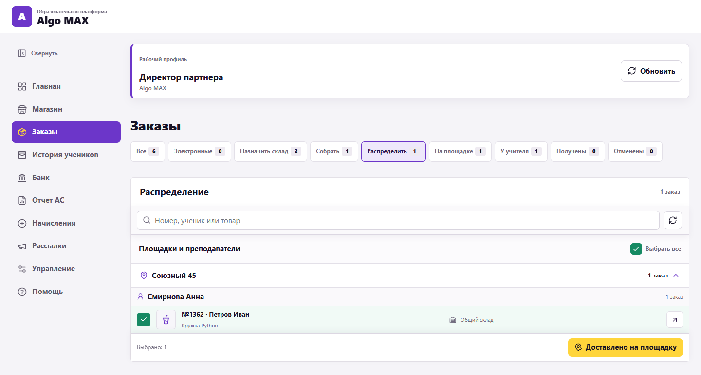](docs/screenshots/order-transfer.png) | [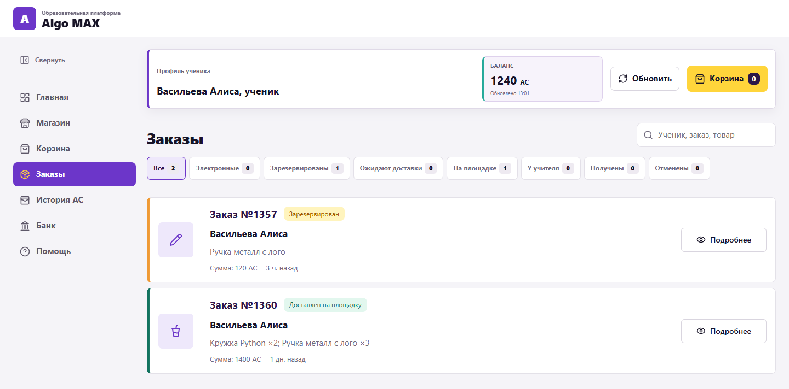](docs/screenshots/customer-orders.png) |

**Подготовка рассылки и проверка получателей**

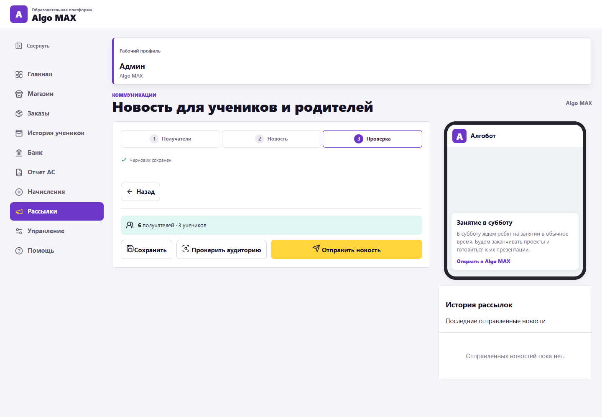

## Игры

**20 игр** с тренировками, обучением, уровнями, соревнованиями и таблицами лидеров. Есть задания на логику, печать, Python, память и реакцию, аркады и огород Копатыча. Результаты формируют общий рейтинг, достижения и личный прогресс. Игровые награды в AC предусмотрены для учеников.

В орбитальных кейсах — 400 коллекционных вариантов предметов, 20 коллекций, редкости и качества оформления. Кейсы открываются за отдельные игровые жетоны, которые можно заработать в соревнованиях.

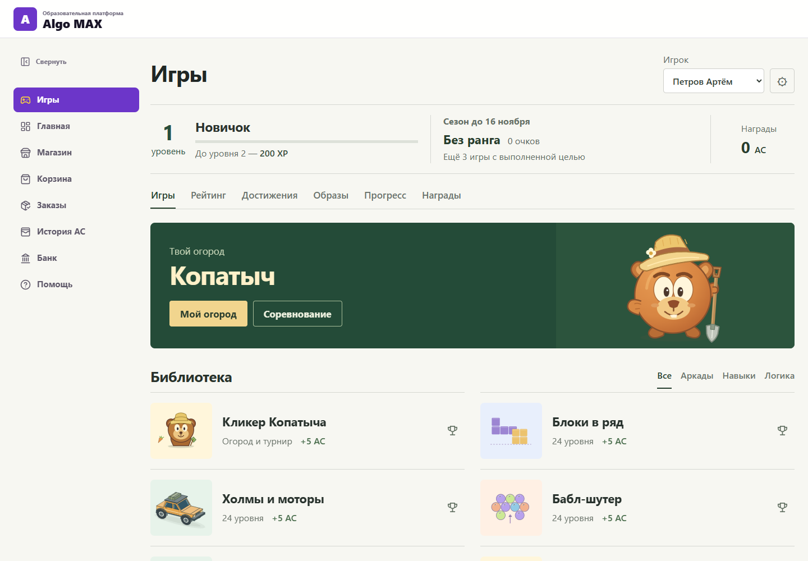

## Архитектура

~~~mermaid
flowchart LR
    U[Ученик · Родитель · Сотрудник] --> M[MAX]
    M --> B[Бот]
    M --> W[Миниприложение]
    B --> A[FastAPI · ролевой API]
    W --> A
    A --> P[(PostgreSQL)]
    A --> R[Redis · ограничения запросов]
    A --> J[Фоновые процессы]
    J --> B
    A --> G[Игры · проверка результата]
    G --> S[(SQLite)]
    X[XLSX · CSV · CRM / LMS] --> A
~~~

| Слой | Реализация |
| --- | --- |
| **Сервер** | Python 3.11+, FastAPI, Pydantic, SQLAlchemy, Alembic. |
| **Данные** | PostgreSQL: ученики, привязки, сотрудники, кошельки, операции, заказы и расписания. |
| **Миниприложение** | HTML, CSS и JavaScript, адаптивные экраны, авторизация по подписанным данным запуска MAX. |
| **Бот** | Подключение аккаунтов, уведомления, обращения и переход в кабинет. |
| **Фоновые процессы** | Банковские проценты, начисления ко дню рождения, сроки сборов и доставка уведомлений. |
| **Игры** | Правила на JavaScript, серверное воспроизведение записи ввода в V8, сохранение прогресса в SQLite. |

Права проверяются сервером с учётом роли, города, партнёра и площадок. Операции с балансами, заказами и остатками выполняются транзакционно.

## Лицензия

Условия просмотра и использования кода описаны в [LICENSE](LICENSE). Проект опубликован для оценки работы автора по лицензии **Portfolio Review License**.
